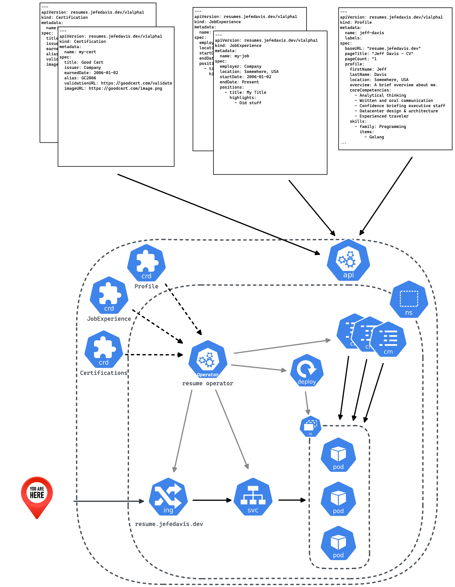

# Resume-Operator - Jeff Davis - resume.jefedavis.dev

A Kubernetes operator built with
[operator-builder](https://github.com/nukleros/operator-builder).

This respository and it's companion [Resume](https://github.com/JefeDavis/Resume) serves two purposes:

* Backup of my resume for rapid deployment and development
* Showcasing some skills while I'm at it:
  - Golang
	- Docker
	- Kubernetes
	- Kubernetes Operators
	- CI/CD
	- GitHub Actions
	- MakeFile
	- Hugo Web Framework
	- HTML5, SCSS
	- Writing Great Documentation

# Why
I hate updating resumes, It's not so much writing the content that I dislike. Instead, it's messing with Word and other tools to adjust margins, dealing with columns, page breaks and just formatting in general. So, why not use a data structure language like `YAML` and let programming deal with all of the formating. Plus, the portability and rapid deployments are a big upshot as well.

Now I can store all my expierence, certifications, skills, and projects in kubernetes manifests and let the code handle the rest. I work with Kubernetes and Kuberentes Operators quite a bit, why not practice what I preach? 

## OK, but is a Kubernetes Operator really necessary?
Absolutely not, but it was a fun exercise and a neat talking point. Additionally with the other tools I've built and worked on  ([yot](https://github.com/vmware-tanzu-labs/yaml-overlay-tool) and [operator-builder](https://github.com/nukleros/operator-builder)) I was able to create a fully functional operator in about 30 minutes.


# K8s Architecture Overview


## Configuration

The `Profile` custom resource drives everything. Beyond the resume content
(`profile`, `web`, `pdf`, `baseURL`, `pageTitle`, `pageCount`), the following
deployment and networking options are supported:

### Networking: Ingress or Route

Exposure is configured with one of two mutually exclusive blocks. If `route` is
set it takes precedence and no Ingress is created; otherwise an Ingress is used
(the default).

```yaml
spec:
  # Option A (default): Ingress
  ingress:
    className: nginx                 # defaults to nginx
    annotations:                     # free-form; put the cert-manager issuer here
      cert-manager.io/cluster-issuer: letsencrypt-staging
    labels:
      team: platform

  # Option B: Gateway API route (e.g. HTTPRoute). Requires the Gateway API CRDs
  # and a Gateway installed in the cluster.
  route:
    apiVersion: gateway.networking.k8s.io/v1   # defaults shown
    kind: HTTPRoute
    hostname: example.com            # defaults to spec.baseURL
    parentRefs:
      - name: public-gateway
        namespace: gateway-system
        sectionName: https
    annotations: {}
    labels: {}
```

The route sends `/` to the resume site and `/convert` to the PDF converter,
matching the Ingress path layout.

### Pod labels, annotations, and security contexts

```yaml
spec:
  podLabels:                         # merged into both pod templates
    example.com/team: platform
  podAnnotations:                    # added to both pod templates
    example.com/scrape: "true"
  podSecurityContext:                # pod-level, applied to both deployments
    runAsNonRoot: true
    seccompProfile:
      type: RuntimeDefault
  securityContext:                   # container-level, applied to the resume container
    allowPrivilegeEscalation: false
    readOnlyRootFilesystem: true
    capabilities:
      drop: ["ALL"]
```

The pod-level `podSecurityContext` is applied to both the resume and
pdf-converter pods. The container-level `securityContext` is applied only to the
resume container; the pdf-converter keeps its required `SYS_ADMIN` capability.

See [`config/samples`](./config/samples) for complete Ingress and Route examples.

## Local Development & Testing

To install the custom resource/s for this operator, make sure you have a
kubeconfig set up for a test cluster, then run:

    make install

To run the controller locally against a test cluster:

    make run

You can then test the operator by creating the sample manifest/s:

    kubectl apply -f config/samples

To clean up:

    make uninstall

## Deploy the Controller Manager

First, set the image:

    export IMG=myrepo/myproject:v0.1.0

Now you can build and push the image:

    make docker-build
    make docker-push

Then deploy:

    make deploy

To clean up:

    make undeploy

## Companion CLI

To build the companion CLI:

    make build-cli

The CLI binary will get saved to the bin directory.  You can see the help
message with:

    ./bin/resumectl help
